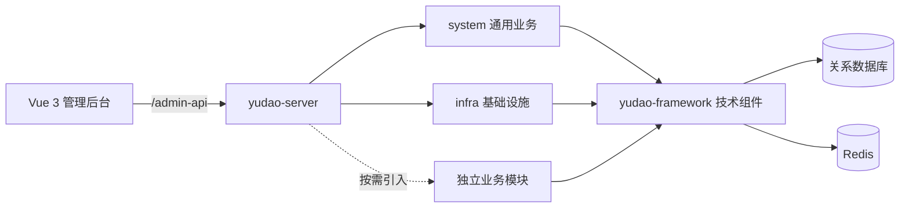

# 框架版本检查与开发导航

> 本文保留首次源码检查时的历史状态。后续已建立 Git 仓库并完成环境启动，当前用法见[本地开发启动与验证](../features/f-001-local-bootstrap.md)，版本组织见[Git 与本地环境组织](../decisions/d-001-git-and-local-environment.md)。

- **类型：** Architecture
- **日期：** 2026-10-19（北京时间）
- **状态：** Confirmed（已核实的事实；后续建议另行标明）
- **范围：** 源码版本、目录结构、基础能力、开发指南和本机工具版本。没有修改业务源码、切换版本、安装依赖、导入数据库或启动服务。

## 背景

本项目希望以芋道 ruoyi-vue-pro 为后续多个项目的开发基座，按实际需求集成基础能力，再开发业务系统。

已确认的使用方向和当前状态：

- 后端使用完整版 ruoyi-vue-pro 的 `master-jdk17` 分支。
- 前端选择 `yudaocode/yudao-ui-admin-vue3`，使用 Vue 3 + Element Plus。
- 前后端均由压缩包原样解压，用户尚未修改配置或功能。
- MySQL 和 Redis 已安装，尚未导入项目 SQL 或配置连接。
- 本次仅熟悉与检查框架，基座开发在检查与沟通完成后开始。

## 一、版本核对结论

前后端均未发现 `.git` 元数据，不能以 `git branch` 或目录名证明分支来源。因此通过官方 GitHub API 获取指定提交的完整文件树，并对本地文件计算 Git blob SHA-1，逐文件核对。

### 后端

| 项目 | 结果 |
| --- | --- |
| 官方仓库 | [YunaiV/ruoyi-vue-pro](https://github.com/YunaiV/ruoyi-vue-pro) |
| 核对分支 | `master-jdk17` |
| 检查时分支提交 | [`7c397bbfae3e768b26e3ee962c5aa7064e8d7c96`](https://github.com/YunaiV/ruoyi-vue-pro/commit/7c397bbfae3e768b26e3ee962c5aa7064e8d7c96) |
| 提交时间 | 2026-10-09 12:33:14，北京时间 |
| 本地 Maven 项目版本 | `2026.09-SNAPSHOT` |
| Java 编译目标 | `17` |
| Spring Boot 声明版本 | `3.5.15` |
| 文件核对 | 排除 `yudao-ui/` 后，8,914 个上游文件全部逐字节一致，无缺失、无内容差异、无额外文件 |

官方后端文件树共 8,924 个文件，其中原 `yudao-ui/` 下的 10 个路径在当前项目布局中不存在；它们是前端说明文件及少量 MES 前端文件，不属于后端源码缺失。其中 5 个 MES 文件已在独立前端目录的对应位置找到。

结论：当前后端内容与检查时官方 `master-jdk17` 分支匹配。由于没有 Git 元数据，这表示源码内容匹配，不表示本地已经建立或检出了这个 Git 分支。

### 前端

实际前端根目录是 `yudao-ui/yudao-ui-admin-vue3-master/`，后续前端安装、启动、构建命令应在此目录执行。

| 项目 | 结果 |
| --- | --- |
| 官方仓库 | [yudaocode/yudao-ui-admin-vue3](https://github.com/yudaocode/yudao-ui-admin-vue3) |
| 匹配的 master 历史提交 | [`0af03a93b6b6300f878e28add69b1c7a9f09ec34`](https://github.com/yudaocode/yudao-ui-admin-vue3/commit/0af03a93b6b6300f878e28add69b1c7a9f09ec34) |
| 该提交时间 | 2026-09-26 10:24:35，北京时间 |
| 文件核对 | 2,904 个文件全部逐字节一致，无缺失、无内容差异、无额外文件 |
| 本地版本声明 | `2026.08-snapshot` |
| 实际核心依赖声明 | Vue `3.5.34`、Element Plus `2.13.7`、Vite `8.1.4`、TypeScript `6.0.3`、Pinia `^3.0.4` |
| Node / pnpm 声明要求 | Node `>=20.19.0`，pnpm `>=8.6.0` |

该源码树也与 PR 来源提交 `1200d57753a68cbcadcc75e2e3e2529345d884ae` 相同；因此不能仅根据相同内容反推唯一的压缩包下载提交。上表采用在 master 历史中找到的合并提交作为可复现参考。

检查时官方前端 `master` 为 [`050bac1eccfbe7393a1568d614151cc99501b949`](https://github.com/yudaocode/yudao-ui-admin-vue3/commit/050bac1eccfbe7393a1568d614151cc99501b949)，提交于北京时间 2026-10-17 00:13:26，版本声明为 `2026.09-snapshot`。

相对这一上游前端快照，本地有 2,684 个相同文件、220 个内容不同文件，以及 246 个上游存在而本地尚无的文件。差异包含 OA、AI1 新增内容，以及 MES、HRM、BPM、系统页面和部分公共组件、Axios 请求处理等更新。这里的“尚无”是两个历史快照的差异，不表示下载包损坏。

结论：前端仓库和技术路线正确，内容是完整的官方历史快照，但与后端取自不同时间点。版本号不同和文件差异本身不能证明接口不兼容；是否满足当前业务需要，仍需固定版本后进行实际联调。

## 二、架构与功能边界

当前是 Spring Boot 多模块单体架构，运行入口为 `yudao-server`。模块化代码不等同于已经拆成多个微服务。

根 `pom.xml` 当前只启用 `yudao-dependencies`、`yudao-framework`、`yudao-server`、`yudao-module-system`、`yudao-module-infra`；`yudao-server/pom.xml` 对应引入 system、infra。其它业务模块的源码存在，但默认未接入当前运行服务。

| 层次 | 主要能力 | 本地状态与适用位置 |
| --- | --- | --- |
| `yudao-module-system` | 用户、角色、菜单与按钮权限、部门、岗位、字典、租户与套餐、登录和操作日志、公告、短信、邮件、站内信、三方登录、OAuth2 | 默认接入；通用系统业务优先复用 |
| `yudao-module-infra` | 代码生成、配置、文件存储、定时任务与日志、API 访问和异常日志、Redis 管理、WebSocket 示例、开发演示 | 默认接入；部分能力需要额外配置 |
| `yudao-framework` | Web、安全认证、MyBatis、Redis、Excel、租户隔离、数据权限、任务、消息、监控、请求保护、测试支持等 starter | 通用技术能力；新增业务通常复用这些组件 |
| 可选通用模块 | BPM 工作流、支付、会员、报表 | 源码存在，默认未接入；按需求配置依赖、数据库及外部服务 |
| 可选业务模块 | 商城、CRM、ERP、MES、WMS、HRM、FMS、PMS、OA、IM、公众号、AI、AI1、IoT | 源码存在，默认未接入；应先核实与具体需求的匹配度 |

“源码存在”“Maven 已接入”“环境已配置”“实际运行通过”是不同状态。本次确认前两项，没有完成运行验证。

## 三、未来实现需求时的目录导航

| 内容 | 对应位置或规则 |
| --- | --- |
| 依赖版本管理 | 根 `pom.xml`、`yudao-dependencies/pom.xml` |
| 启动与运行配置 | `yudao-server/src/main/java/.../YudaoServerApplication.java`、`yudao-server/src/main/resources/application*.yaml` |
| 用户、角色、组织等现有系统业务 | `yudao-module-system/src/main/java/cn/iocoder/yudao/module/system/` |
| 文件、任务、配置等基础设施 | `yudao-module-infra/src/main/java/cn/iocoder/yudao/module/infra/` |
| 独立的新业务领域 | 按官方模块规范新增 `yudao-module-<业务名>`，在根 POM 注册并由 server 引入 |
| 管理后台接口 / 用户端接口 | 模块内 `controller/admin` / `controller/app`，统一前缀分别为 `/admin-api` / `/app-api` |
| 接口入参与返回对象 | `controller/.../vo`；沿用 `CommonResult`、`PageResult`、校验与错误码机制 |
| 业务逻辑 | `service` |
| 表实体 / 数据库访问 / Redis 访问 | `dal/dataobject`、`dal/mysql`、`dal/redis`；复杂 Mapper XML 通常在 `src/main/resources/mapper` |
| 跨模块能力 | 优先通过模块 `api` 和 DTO 暴露，避免形成 Maven 循环依赖 |
| 模块自己的框架接入 | 模块内 `framework`；跨模块通用技术封装再考虑 `yudao-framework` |
| 前端页面、列表和表单 | 前端根目录的 `src/views/<模块>/<功能>/` |
| 前端接口调用与类型 | 前端根目录的 `src/api/<模块>/<功能>/` |
| 前端公共组件与方法 | `src/components`、`src/hooks`、`src/utils` |
| 路由与登录权限状态 | `src/router`、`src/store/modules/permission.ts`、`src/permission.ts`；常规菜单路由由后台菜单数据生成 |
| 前端请求封装 | `src/config/axios`，统一处理 Token、租户标识和错误提示 |
| 初始数据库脚本 | `sql/mysql/ruoyi-vue-pro.sql`，其它数据库有各自目录 |

以上代码路径均相对于后端或已明确标注的前端根目录。后续新需求应先判断是现有能力扩展、通用技术封装还是独立业务，再确定落点。

已阅读“岗位管理”的前后端实现，可作为普通 CRUD 参考：后端 `controller/admin/dept/PostController.java`、`service/dept`、`dal/dataobject/dept/PostDO.java`，前端 `src/api/system/post/index.ts`、`src/views/system/post/index.vue` 和 `PostForm.vue`。

需要继续沿用的集成规则：

- 后端接口的 `@PreAuthorize` 权限标识，应与菜单、按钮权限及前端 `v-hasPermi` 对应。前端隐藏按钮不能代替后端权限检查。
- 当前前后端都开启多租户相关配置。租户隔离与部门、本人等数据范围权限分别处理；新表需要明确是否属于租户、是否注册部门或用户的数据权限规则。
- `BaseDO` 提供审计和逻辑删除字段；需要显式租户属性的实体可使用 `TenantBaseDO`。新建实体并不自动完成业务数据权限接入。
- 代码生成器当前 `front-type: 20` 对应 Vue 3 + Element Plus，符合所选前端；生成后仍须核对业务规则、权限、租户、字段校验和菜单。
- `yudao-server` 负责启动、配置和模块装配；具体业务逻辑放在对应业务模块。

## 四、本机环境与启动准备

| 项目 | 检查结果 |
| --- | --- |
| Java | `17.0.2`，命令来自 `D:/coding/jdk-17.0.2/bin/java.exe` |
| Maven | `3.9.11`，使用同一个 Java 17.0.2；版本命令有 `Access is denied.` 提示但仍返回版本信息，构建行为尚未验证 |
| Node.js | `v24.12.0` |
| pnpm | `10.28.2` |
| MySQL / Redis | 用户确认已安装；版本、连接、库表和权限尚未验证 |
| Git | 已安装；当前前后端源码尚无 Git 元数据 |
| 前端依赖 | 未发现 `node_modules`，尚未安装或构建 |

从声明层面看，本机 Java 主版本和 Node、pnpm 版本满足当前项目选择。Java 17.0.2 是较早的补丁版本，后续固定开发环境时可一并选择较新的 JDK 17 维护版本；本次未更换任何工具。

本地默认配置：

- 后端启用 `local` profile，端口 `48080`，默认指向本机 MySQL `3306` 的 `ruoyi-vue-pro` 数据库和 Redis `6379` 的 0 号库。
- 前端 `pnpm dev` 使用 `env.local` 模式，读取 `.env` 和 `.env.local`；默认端口 `80`，API 指向 `http://localhost:48080/admin-api`。
- 前端 `dev-server` 使用另一套 dev 配置，默认指向官方演示 API；本机联调时需要区分两个命令。
- `local` 环境默认关闭图片验证码和 Quartz 自动配置，开启模拟认证；API 访问日志记录默认关闭。因此对应能力不能按演示站效果推定已启用。
- 只初始化基础模块时，按官方快速启动说明使用主 SQL；Quartz 等附加模块的数据库准备按后续实际启用情况处理。

本次未执行 Maven 编译、pnpm 安装构建、单元测试或接口联调，不能据此宣称服务已经可运行。已解析检查本地 47 个 POM，XML 与其中启用的子模块路径均未发现问题；此项不验证依赖可下载或代码可编译。

## 五、官方指南导航

文档按实际需求逐项阅读和核对，不以首页功能列表替代当前源码事实。已梳理的核心入口如下：

| 场景 | 官方资料 |
| --- | --- |
| 后端版本选择、数据库与启动 | [后端快速启动](https://doc.iocoder.cn/quick-start/) |
| 前端仓库选择与启动 | [前端快速启动](https://doc.iocoder.cn/quick-start-front/) |
| 模块和分层职责 | [项目结构](https://doc.iocoder.cn/project-intro/) |
| 增加独立业务领域 | [新建模块](https://doc.iocoder.cn/module-new/) |
| 将所需模块迁入新项目 | [迁移模块](https://doc.iocoder.cn/migrate-module/) |
| 菜单、接口与操作权限 | [功能权限](https://doc.iocoder.cn/resource-permission/) |
| 部门、用户等数据范围 | [数据权限](https://doc.iocoder.cn/data-permission/) |
| 租户字段隔离 | [SaaS 多租户](https://doc.iocoder.cn/saas-tenant/) |
| 页面、表单、请求等约定 | [Vue 3 开发规范](https://doc.iocoder.cn/vue3/dev-spec/) |

已核对快速启动、模块结构、前端规范、权限、租户和本地代表性实现。其它业务手册已识别入口，尚未逐一审查全部业务细节；需要某一能力时，继续对照对应模块源码和手册。

## 六、检查后的建议与待确认事项

以下为建议，尚未执行或确认为项目决策：

1. 在基座开发前确定前端版本基线。倾向将前端对齐检查时的官方 master，再固定前后端提交并实际联调；也可保留已验证完整的当前前端快照，但需要接受与较新后端的差异核对工作。
2. 建立 Git 版本管理与上游来源记录，保留可回溯基线，便于以后复用基座、追踪自定义变更和选择性吸收上游修复。
3. 在专用开发数据库中完成初始化和连接配置，安装前端依赖，验证后端启动、登录、菜单、权限和代表性 CRUD。主初始化 SQL 含有建表前删除语句，应选定待初始化数据库后再执行。
4. 基座功能规划前，确认主要使用人群、单组织或多客户租户场景、首个业务系统及眼下最需要补足的能力，再决定模块取舍。

未来需求的处理顺序：明确实际痛点 → 检查框架已有能力 → 确定模块与数据模型 → 定义权限、租户、菜单及数据库变更 → 实现前后端 → 针对需求验证 → 更新项目记录。

## 依据与复核方法

- 后端清单：GitHub API `repos/YunaiV/ruoyi-vue-pro/git/trees/7c397bbfae3e768b26e3ee962c5aa7064e8d7c96?recursive=1`。
- 前端历史清单：GitHub API `repos/yudaocode/yudao-ui-admin-vue3/git/trees/0af03a93b6b6300f878e28add69b1c7a9f09ec34?recursive=1`。
- 前端当前参考清单：GitHub API `repos/yudaocode/yudao-ui-admin-vue3/git/trees/050bac1eccfbe7393a1568d614151cc99501b949?recursive=1`。
- 三份递归文件清单均未截断；逐文件使用 `SHA1("blob " + 文件字节数 + NUL + 文件字节)` 比较。版本匹配结果不是依据项目目录名得出。
- 前端本地完整 Git 内容树为 `217dfcf0fa6e4f672df38b3edee913d36ceb2383`；在该快照使用上游记录的文件模式进行计算。内容校验通过不代表 Windows 解压目录保留了 Unix 可执行权限。
- 工具版本实际执行了 `java -version`、`mvn -version`、`node --version`、`pnpm --version`；并读取了根 POM、BOM、server 装配配置、前端 package.json、环境文件及代表性业务源码。
- 文件数量描述的是写入本检查记录之前的原始下载代码；本次新增的 `docs/kb/` 文档不计入上游源码一致性统计。
